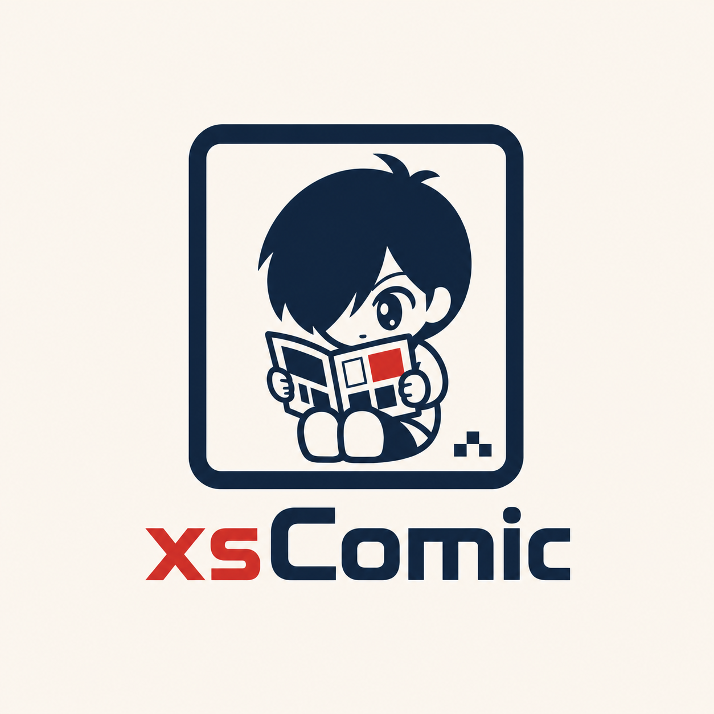

<p align="center">
  
</p>

**xsComic** is a native macOS reader for CBR, CBZ, and friends. I cooked it up
because I did not want unvetted third-party software on my work partition—and
because Codex could make something passable in five minutes.

It then became an experiment: can an LLM help make aggressively optimized
native software whose source is also pleasant for a human being to inspect?
These tools are famously better at adding code than removing it. Recent models
seemed good enough to try reversing that tendency.

The result is a 510 KB app bundle, about 220 KB of which is icon resources. It
launches very quickly, has no third-party code, and never accesses the network.
The source is deliberately small, heavily annotated, and arranged to be read.
(The RAM footprint could still use some work.)

## What it does

- opens CB7/7z, CBR/RAR, CBT/tar, CBZ/ZIP, and image directories
- reads one or two pages at a time, left-to-right or right-to-left
- offers keyboard controls, pinch-and-drag zooming, fit, and actual size
- includes a page sidebar, direct page jump, and adjacent-volume continuation
- quietly prepares the pages you are most likely to turn to next

The minimum supported system is macOS 14.

## Give it a try

Build and open xsComic:

```sh
./scripts/build-and-run.sh
```

That is the whole getting-started procedure. The build uses SwiftPM and Apple's
developer tools; there is no Xcode project or dependency installation.

## If you are curious

The more technical material lives in [`docs/`](docs/):

- [the project guide](docs/guide.md) explains the features, architecture, and
  codebase;
- [the optimization record](docs/optimization.md) keeps the before-and-after
  measurements and the reasoning behind them;
- [the release procedure](docs/releasing.md) covers tests, packaging, signing,
  and notarization;
- [the raw metrics](Metrics/) preserve the machine-readable evidence.

## License

The software is **AGPL-3.0-or-later**. Documentation and measurements are
**CC BY-SA 4.0**. The xsComic name and everything under `Assets/` are expressly
excluded: no license is granted for the branding or character artwork. The
short, unambiguous map is in [`LICENSING.md`](LICENSING.md).

This is still a release candidate. Before publishing a binary, the project
needs a permanent bundle identifier, public support/security contact,
Developer ID signature, and notarization. Those decisions are left to the
eventual publisher rather than guessed here.
